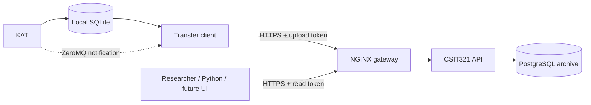

# KAT transfer client, gateway and API

KAT keeps recording into its existing SQLite database. The transfer client sends
pending records to an authenticated HTTP API behind NGINX. Only the API server
connects to PostgreSQL; laptops and researchers need no PostgreSQL credentials.



## Try the local demonstration

Use Python 3.12+ and Docker Desktop with its Linux engine running. Record some
data with KAT first so `~/katdata.db` exists. From this
`kat-transfer` folder, create and activate a Python environment if you do not
already have one:

```powershell
python -m venv .venv
.venv\Scripts\Activate.ps1
python -m pip install -r requirements.txt
python tools/demo.py
```

The demo generates an ignored `.env` file with local database settings if
needed, starts PostgreSQL, the API and NGINX, creates a temporary demo user and
write token through the gateway's token command, then transfers pending
measurement and environment rows from `~/katdata.db`. The one-time token is
saved in ignored `.env` for local use. It compares archived JSON text with
SQLite. Record counts depend on the data recorded with KAT.
Successful uploads update the original KAT database's `xfer` stamps.

Open [API documentation](http://127.0.0.1:8080/docs). To try data endpoints,
click **Authorize** and paste the `KAT_API_WRITE_TOKEN` from `.env`; it can read
and upload. Read tokens cannot upload.

The demo uses the existing KAT database at `~/katdata.db` and the local gateway
at `http://127.0.0.1:8080`. If no rows are pending, it exits with an
already-transferred message. The `origin` defaults to `fake` for development;
choose an appropriate origin for data intended to be retained as real measurements.

For a deliberate local replay, `python tools/demo.py --resend` first creates a
timestamped `katdata.backup-YYYYMMDD-HHMMSS.db` beside the source, then clears its
measurement and environment `xfer` stamps and resends all rows. These stamps
are shared by clients using that source database: a local demo upload does not
mean that the office archive has received the same records.

## Run the transfer client separately

Set your personal upload token for the current terminal. For the local demo,
load its generated token from `.env`:

```powershell
$env:KAT_API_WRITE_TOKEN = (Get-Content .env | Where-Object { $_ -like 'KAT_API_WRITE_TOKEN=*' }) -replace '^KAT_API_WRITE_TOKEN=', ''
python -m katxfer.service --doctor
python -m katxfer.service --status
python -m katxfer.service --once
python tools/verify_transfer.py
python tools/show_state.py --limit 5
```

Leave out `--once` to keep the client running. Its startup catch-up and periodic
sweep still find unsent rows even if ZeroMQ notifications are absent or lost.
The existing ZeroMQ implementation is retained; see [its notes](docs/zeromq.md).
After a successful transfer, a second service `--once` run sends zero rows.

`config.toml` reads `~/katdata.db` and targets the local NGINX gateway.
`config.tunnel.toml` targets the office API through the temporary SSH tunnel;
`config.live.toml` targets the administrator's final HTTPS route.
`config.example.toml` is a copyable template for another laptop.
Client `[remote]` now contains only `kind = "gateway"`, URL, token, timeout and
an optional `ca_file` for a private certificate authority. Old direct database
configs fail with a migration message. Remote HTTP is allowed only for loopback;
use trusted HTTPS for a remote server.

## What protects the transfer

1. The client reads a batch where `xfer IS NULL` and uploads its parent experiments.
2. The API authenticates and validates each table batch before executing SQL.
3. Every table upsert and its token-attributed audit record commit in one
   PostgreSQL transaction. The response confirms `committed`, `sent` and `applied`.
4. Only a complete successful acknowledgement allows SQLite's `xfer` to be set.
5. Timeouts, rejected requests and incomplete acknowledgements leave rows pending.
   A lost reply after commit causes a safe resend on the existing primary keys.

The original data schema and identity rules are retained. Measurement identity is
`(systemid, run, row_no)`; environment identity is `(systemid, timestamp)`.
Repeated environment keys keep the last sample, as in the existing archive.
JSON remains text inside the HTTP payload and is stored as PostgreSQL `json`,
so formatting survives the transfer. KAT epoch-millisecond timestamps are
converted to timezone-aware ISO 8601. Each table batch is atomic; the parent,
measurement and environment requests are separate transactions.

## Read data through the API

All data endpoints require `Authorization: Bearer <token>`.

| Method | Route | Purpose |
|---|---|---|
| GET | `/health` | Process health, no archive data |
| GET | `/v1/status` | Archive counts and database availability |
| POST | `/v1/ingest/experiments` | Upsert parent experiment rows |
| POST | `/v1/ingest/experimental-data` | Upsert measurement rows and audit |
| POST | `/v1/ingest/environment` | Upsert environment rows and audit |
| GET | `/v1/experiments` | List experiments; filter by systemid or origin |
| GET | `/v1/experiments/{systemid}/{run}` | Retrieve one experiment |
| GET | `/v1/experimental-data` | Read measurements; filter by systemid, run or origin |
| GET | `/v1/environment` | Read environment; filter by systemid, origin, from_ts or to_ts |
| GET | `/v1/transfers` | Read successful transfer audit records |
| GET | `/docs`, `/openapi.json` | Interactive documentation and API contract |

List endpoints return `{ "items": [...], "limit": 100, "offset": 0 }` in a stable
key order. Use `limit` from 1 to 1000 and a nonnegative `offset`. Timestamps use
ISO 8601 with a timezone; environment ranges are inclusive. The `data` field is
the original JSON string, or SQL null. Schema details and example requests are
in [the API guide](docs/gateway-api.md).

Replace the example system ID and run number below with values recorded by KAT.
Set your personal read token in the current terminal:

```powershell
$env:KAT_API_READ_TOKEN = '<personal read token issued by an administrator>'
python tools/read_run.py --systemid K4-RIG-01 --run 1 --csv run1.csv
```

## Tests

Install the development dependencies, expose the isolated test database only
on loopback, and require PostgreSQL rather than accepting skipped checks:

```powershell
python -m pip install -r requirements-dev.txt
python tools/new_demo_env.py     # only if .env does not exist yet
# The test override publishes PostgreSQL on 127.0.0.1:25432.
docker compose -f docker-compose.yml -f docker-compose.test.yml up -d --build --wait
$env:KAT_REQUIRE_PG = '1'
python -m pytest tests -q
```

Tests recreate only `kat_gateway_test`, never the demo or live archive. Default
test credentials match `tools/new_demo_env.py`. Override `KAT_TEST_PG_HOST`,
`KAT_TEST_PG_PORT`, `KAT_TEST_PG_USER` and `KAT_TEST_PG_PASSWORD` if needed.
Without `KAT_REQUIRE_PG=1`, database-dependent tests skip if PostgreSQL is absent.
The GitHub Actions workflow runs the suite with PostgreSQL required.

## Deploy on the development server

Follow [the deployment guide](docs/deployment.md). The supplied live URL
`https://192.168.40.100/csit321` is an integration template, not a claim that this
route or a matching certificate is already configured. The administrator must
confirm the HTTPS hostname, certificate and NGINX route. The live compose file
runs the API against the existing archive and does not create or reset a database.

The setup email provides each teammate a server account with Python 3.12 and no sudo access.
The guide therefore starts with a native Python venv deployment and supplies
an administrator service template. Server Docker deployment is optional and
requires administrator-provided access. The confirmed pgAdmin archive is
`experimentaldata`, using the development login `csit`. Use the read-only
[pgAdmin checks](docs/pgadmin-checks.sql) to inspect its schema before uploading.

Build a server-only source archive with `python tools/package_server.py`.
It packages the current local API changes, verifies their hashes, and excludes
local credentials, the VPN profile, databases and Python environments. Follow
the deployment guide to upload it and recreate the venv in the Linux account.

The standard local compose file publishes only NGINX on `127.0.0.1:8080`.
PostgreSQL is private unless the explicit test override is used. Stop the demo
with `docker compose down`; its database volume is preserved.

## Files

- `katxfer/`: SQLite transfer loop and HTTP sink
- `katgateway/`: authentication, validated API models and server-only PostgreSQL access
- `deploy/`: local and live NGINX configuration
- `tools/`: demo, fake data, verification, diagnostics and a researcher read example
- `schema/`: existing KAT/PostgreSQL schemas and the live token migration
- `tests/`: transfer, API, retry, transaction, access-control and ZeroMQ checks
- `requirements.txt`: client dependencies; `requirements-server.txt`: server dependencies

The gateway now uses per-user read/write tokens, expiry/revocation, and
token-attributed transfer records. The future user sign-in/token-issuance UI,
per-rig permissions, and an approved public-data policy remain follow-up work.
`origin` and `src_host` are client-supplied provenance, not verified identity.
Offset pagination is for bounded reads; pause writes when producing a fixed
verification snapshot. Backups and service monitoring remain deployment
responsibilities.
